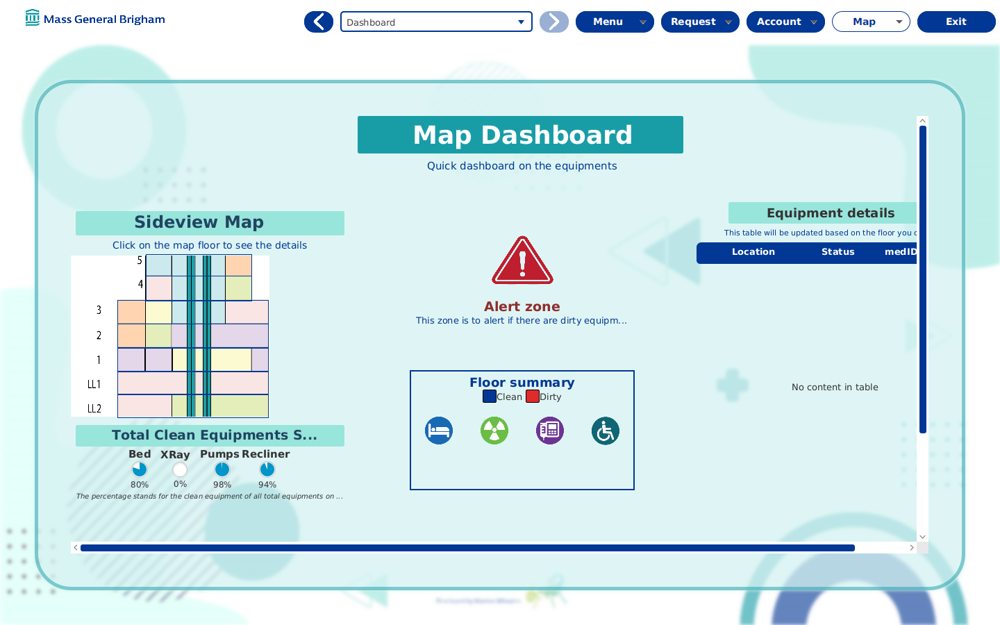
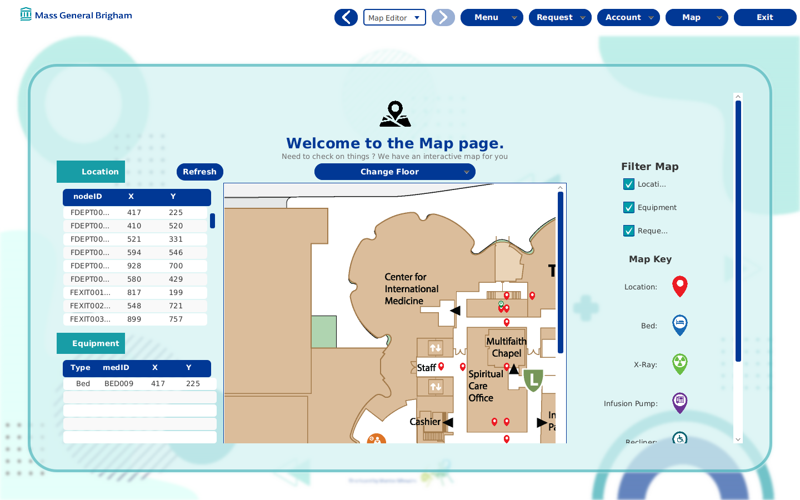
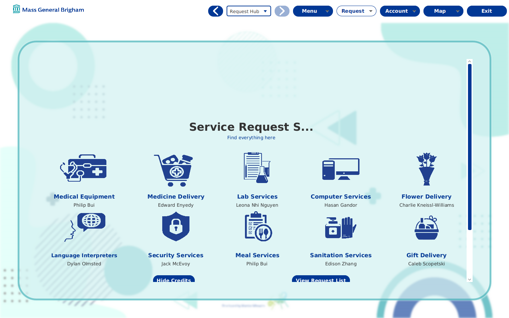

# BWH Medical Service Request System

[](wApplication/build.gradle)
[](wApplication/build.gradle)
[](wApplication/build.gradle)
[](wApplication/build.gradle)
[](#credits)

**A hospital service-request and equipment-tracking desktop application, modelled on Brigham and Women's Hospital.** Staff log in by role, file thirteen kinds of service request against a location on the hospital map, track medical equipment by location and status, and watch a dashboard of beds, pumps, recliners and X-ray machines. A map editor places locations and equipment on the floor plans.



Built in spring 2022 by Team W of WPI's CS 3733 Software Engineering course, an eleven-person Agile team.

## What it does

- **Service requests.** Medical equipment, lab test, medicine delivery, meal, flower, gift delivery, sanitation, cleaning, security, computer service, language interpreter, internal patient transport and external transport. Each request records its location, the assigned employee, an emergency flag, a status and timestamps. A request hub lists and filters them.
- **Equipment tracking.** Beds, infusion pumps, recliners and X-ray machines carry an id, a type, a location and a status. The equipment list and the dashboard read the same records.
- **Dashboard.** Progress gauges per equipment type, and alerts such as six dirty beds on a floor.
- **Map editor.** Floor plans for five floors, two lower levels, the ground floor and a side elevation. Toggle locations, equipment and requests as dots, pan and scale the map, and add or edit a location in place.
- **Accounts.** Login with hashed and salted passwords and nine roles with access levels (admin, doctor, nurse, staff, security, sanitation, technician, language interpreter).
- **Messaging, profiles and extras.** A group-chat page, employee profiles with pictures, an emergency button, a help page, and two mini-games.
- **CSV in and out.** Every table loads from the CSV files under `wApplication/CSVs/` at start and exports back to CSV.
- **Partner APIs.** Three jars from sister teams (language interpretation, external transport, a transfer API) plug into an API hub page.





## How it is built

A JavaFX 18 application on Java 11 with JFoenix controls, built by Gradle 6 with the OpenJFX plugin. The code is three layers under `edu.wpi.cs3733.d22.teamW`: `wApp` holds the FXML views, their controllers and custom controls (hospital map, request table, employee table, filters); `wDB` holds the DAO interfaces and implementations, the manager singletons, the entities and enums, a request facade and factory, and the CSV controller; `wMid` holds `Main`, which seeds an embedded Apache Derby database from the CSVs and launches the JavaFX `App`. Page, window, account and transition managers sit in `Managers`. Tests use JUnit 5 and TestFX against the database layer.

## Install and run

```bash
git clone https://github.com/phbui/BWH-Medical-Service-Request-System.git
cd BWH-Medical-Service-Request-System/wApplication
./gradlew run          # Java 11 or newer with JavaFX resolved by the Gradle plugin
./gradlew test         # database-layer tests
./gradlew jar          # a runnable jar with Main-Class set
```

The first start creates the Derby database next to the project and loads the CSVs. The seed accounts are listed in `CSVs/UnhashedEmployees.csv`; the `admin` account opens every page. The Gradle wrapper jar in this repo was an empty file until this README landed, so a fresh clone needed a local Gradle 6. The wrapper is restored, and `./gradlew` works again.

## Layout

```
wApplication/
  src/main/java/edu/wpi/cs3733/d22/teamW/
    wApp/        FXML controllers, custom controls, service-request view models, map editor
    wDB/         DAOs, managers, entities, enums, CSV controller, request facade and factory
    wMid/        Main and the JavaFX App
    Managers/    page, window, account, transition, background and menu-bar managers
  src/main/resources/.../wApp/views/   FXML pages, service-request forms, pop-ups
  src/main/resources/.../wApp/assets/  floor-plan images and icons
  CSVs/          seed data for every table
  libs/          partner-team API jars
```

## Credits

Team W (WumboWhowies), WPI CS 3733 Software Engineering, D term 2022. Contributors on GitHub: phbui, epoll31, EdisonZhang0202, cscopetski, charkw, NhiNguyencmt8, hzgand and jasonodell2001. Development documents: https://tinyurl.com/CS3733-BWH-TeamW.

## License

No license file is included. All rights reserved by the authors.
